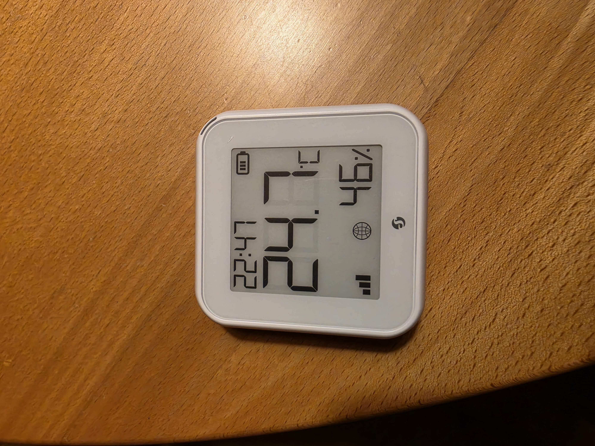
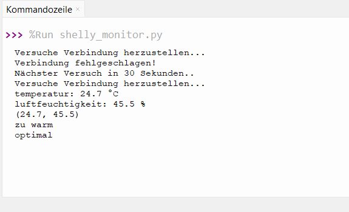
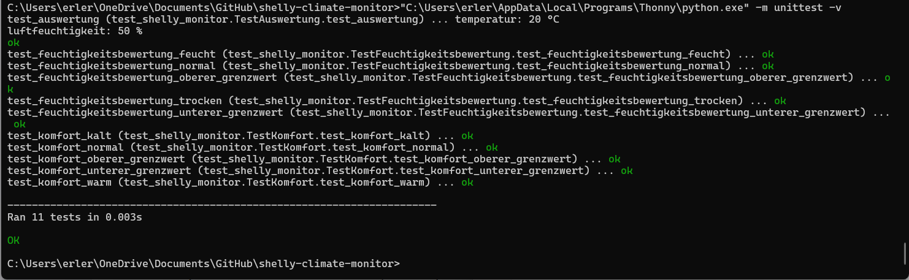

# Shelly Climate Monitor

A Python console application that reads temperature and relative humidity from a Shelly H&T Gen3 over its local HTTP RPC interface.

**Status: completed learning project.** The prototype demonstrates sensor communication, data extraction, basic network error handling, and unit testing. It is not a production monitoring system. Further sensor-development work continues in [AISTHETRON AER](https://github.com/florianerler/aisthetron-aer).



## Features

- Read sensor data over Wi-Fi using `requests`.
- Extract temperature in °C and relative humidity in %.
- Classify readings using simple, developer-defined thresholds.
- Retry after network failures, with approximately 30 seconds between requests plus request duration.
- Keep the device address in a local `config.py` file.
- Verify processing functions with 11 unit tests, including boundary cases.

The console interface is in German. Measurements are printed, not saved.

## Getting started

Requirements: Python 3, a Shelly H&T Gen3 accessible on your local network, and the dependencies listed in [requirements.txt](requirements.txt).

1. Clone or download this repository and open a terminal in its directory.
2. Install dependencies:

   ```text
   python -m pip install -r requirements.txt
   ```

3. Copy [config.example](config.example) to `config.py`. Edit `SHELLY_IP` to contain your sensor's local IP address. The local configuration is excluded from Git tracking; do not overwrite an existing configuration when updating.
4. Start the application:

   ```text
   python shelly_monitor.py
   ```

Stop with `Ctrl+C`. If your Windows installation uses the Python launcher, replace `python` with `py`.

Battery-powered sensors may sleep and become temporarily unreachable. Successful requests may also return unchanged readings.

## Example output



```text
Versuche Verbindung herzustellen...
temperatur: 24.7 °C
luftfeuchtigkeit: 45.5 %
(24.7, 45.5)
zu warm
optimal
```

## How it works

| Function | Responsibility |
| --- | --- |
| `abfrage()` | Request `/rpc/Shelly.GetStatus` with a five-second timeout and return HTTP status and JSON |
| `auswertung(wert)` | Extract and print temperature and humidity, then return them as a tuple |
| `komfort(wert)` | Classify temperature: below 19 °C, 19–23 °C inclusive, or above 23 °C |
| `feuchtigkeitsbewertung(wert)` | Classify humidity: below 35%, 35–65% inclusive, or above 65% |

The thresholds are programming examples, not universal indoor-comfort standards. The main loop runs only when the module is executed directly.

## Tests

After installing dependencies and creating `config.py`, run:

```text
python -m unittest -v
```

The 11 tests cover temperature classification, humidity classification, their exact boundaries, and extraction from a simulated sensor response. No live sensor is needed for these tests, but `config.py` is required when importing the application.

The documented development run completed with 11 passing tests:



This records a past local run; it is not a live CI status. Network failures, HTTP error responses, incomplete data, and long-term behavior are not covered by this suite.

## Limitations

- HTTP status codes are returned but not checked before processing the response.
- Missing measurement fields or unexpected value types can terminate the application.
- Network error reporting is basic; the polling interval is fixed.
- There are no timestamps, persistent logs, graphs, or freshness checks.
- Console output and measurement extraction are partly coupled.
- Long-term reliability and measurement accuracy have not been validated.

## Development notes

This project progressed from HTTP and JSON exercises to live sensor access, modular evaluation, external configuration, and automated tests. The detailed [development history and lessons learned](docs/development-notes.md) are retained separately.

AI assistance was used for conceptual explanations, debugging guidance, and documentation. The project is retained as a record of learning; no further feature development is currently planned.

## License

[MIT License](LICENSE), copyright © 2026 Florian Erler.
